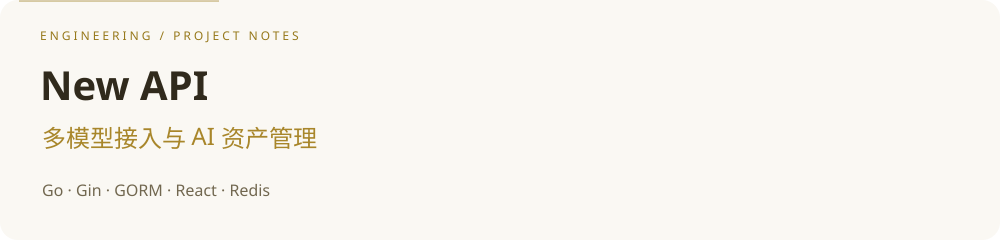

## ✨ 项目速览

- 围绕统一模型 API、渠道管理、动态计价与负载均衡组织 AI 网关能力。
- 按 Router → Controller → Service → Model 分层，Relay 模块承接模型提供方适配。
- 包含鉴权、限流与管理控制台；阅读时可沿请求路由、模型转发和数据模型逐层深入。

### 🧭 源码阅读路线

- **[请求路由](router/)**
- **[模型转发](relay/)**
- **[鉴权与限流](middleware/)**
- **[管理控制台](web/)**

> 项目身份与上游归属保留为 **New API / QuantumNous**。部署与完整功能说明见 [中文完整文档](README.zh_CN.md)、[英文文档](README_EN.md)；使用及分发请阅读 [LICENSE](LICENSE)、[NOTICE](NOTICE) 与 [第三方许可](THIRD-PARTY-LICENSES.md)。

---

# New API

**中文** | [English](README_EN.md)

新一代 **LLM 网关与 AI 资产管理系统**：多模型统一接入、通道池、动态计价与智能负载均衡。

> 本仓库默认中文说明。完整英文文档见 [README_EN.md](README_EN.md)。

## 项目定位

面向团队与企业的下一代 AI API 聚合平台，把多个模型与渠道收敛到统一网关。

## 核心能力

- 多模型统一网关
- 通道池与负载均衡
- 动态计价
- AI 资产 / 渠道管理

## 快速开始

请参考英文文档中的安装与部署章节：

- [README_EN.md](README_EN.md)

或查看仓库 web/ 与相关部署说明。

## License

以仓库内 LICENSE / 上游声明为准。
