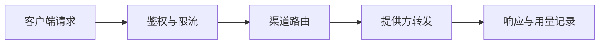

<picture><source media="(prefers-color-scheme: dark)" srcset="docs/showcase/hero-dark.svg"><source media="(prefers-color-scheme: light)" srcset="docs/showcase/hero-light.svg"></picture>

<!-- engineering-guide:start -->

<h2><picture><source media="(prefers-color-scheme: dark)" srcset="docs/showcase/section-01-dark.svg"><source media="(prefers-color-scheme: light)" srcset="docs/showcase/section-01-light.svg"></picture></h2>

**模型网关的请求、渠道与计费链路**。把多个模型提供方与渠道收敛到统一 API 与管理控制台，围绕接入、路由、访问控制与费用管理组织阅读。

- Router、Controller、Service 和 Model 分层组织业务，Relay 承接模型请求与提供方协议适配。
- 数据库兼容和计费语义是关键约束：新增逻辑需考虑 SQLite、MySQL 与 PostgreSQL 及不同提供方字段语义。
- 管理控制台与网关 API 服务不同类型的用户，部署后应分别验证管理流程和模型调用。

📖 **[阅读完整工程导读](docs/PROJECT_GUIDE.md)**：源码路径、最短运行路线、演示验收与当前边界。
<!-- engineering-guide:end -->

<h2><picture><source media="(prefers-color-scheme: dark)" srcset="docs/showcase/section-02-dark.svg"><source media="(prefers-color-scheme: light)" srcset="docs/showcase/section-02-light.svg"></picture></h2>

- 围绕统一模型 API、渠道管理、动态计价与负载均衡组织 AI 网关能力。
- 按 Router → Controller → Service → Model 分层，Relay 模块承接模型提供方适配。
- 包含鉴权、限流与管理控制台；阅读时可沿请求路由、模型转发和数据模型逐层深入。

### 🧭 源码阅读路线

- **[请求路由](router/)**
- **[模型转发](relay/)**
- **[鉴权与限流](middleware/)**
- **[管理控制台](web/)**

> 项目身份与上游归属保留为 **New API / QuantumNous**。部署与完整功能说明见 [中文完整文档](README.zh_CN.md)、[英文文档](README_EN.md)；使用及分发请阅读 [LICENSE](LICENSE)、[NOTICE](NOTICE) 与 [第三方许可](THIRD-PARTY-LICENSES.md)。

---

# New API

**中文** | [English](README_EN.md)

新一代 **LLM 网关与 AI 资产管理系统**：多模型统一接入、通道池、动态计价与智能负载均衡。

> 本仓库默认中文说明。完整英文文档见 [README_EN.md](README_EN.md)。

<h2><picture><source media="(prefers-color-scheme: dark)" srcset="docs/showcase/section-03-dark.svg"><source media="(prefers-color-scheme: light)" srcset="docs/showcase/section-03-light.svg"></picture></h2>

面向团队与企业的下一代 AI API 聚合平台，把多个模型与渠道收敛到统一网关。

<h2><picture><source media="(prefers-color-scheme: dark)" srcset="docs/showcase/section-04-dark.svg"><source media="(prefers-color-scheme: light)" srcset="docs/showcase/section-04-light.svg"></picture></h2>

- 多模型统一网关
- 通道池与负载均衡
- 动态计价
- AI 资产 / 渠道管理

<h2><picture><source media="(prefers-color-scheme: dark)" srcset="docs/showcase/section-05-dark.svg"><source media="(prefers-color-scheme: light)" srcset="docs/showcase/section-05-light.svg"></picture></h2>

请参考英文文档中的安装与部署章节：

- [README_EN.md](README_EN.md)

或查看仓库 web/ 与相关部署说明。

<h2><picture><source media="(prefers-color-scheme: dark)" srcset="docs/showcase/section-06-dark.svg"><source media="(prefers-color-scheme: light)" srcset="docs/showcase/section-06-light.svg"></picture></h2>

以仓库内 LICENSE / 上游声明为准。
